<div align="center">


# PetLife

**Your pet's vaccination card, always in your pocket.**

Mobile app for dog and cat owners: digitize the paper vaccination card from a photo, get reminders, and keep track of feeding and walks.


**English** · [Português](README.pt-BR.md)

</div>

---

## About

Vaccination cards are on paper, the handwriting is hard to read, and nobody remembers when each dose expires. Daycares, hotels and groomers ask for proof on the spot, and the card is at home.

PetLife turns the paper card into a clean digital one, sends reminders before each dose expires, and helps with daily care (meals, walks, and how much food the pet needs).

This is a portfolio and learning project, built step by step with a feature-based architecture so every part is easy to find and explain.

## Status

| Area | State |
|---|---|
| Product spec, 14 screen designs, architecture | Done |
| Expo project, TypeScript, theme tokens, fonts (Fredoka and Nunito) | Done |
| Welcome, login, sign up and new pet screens (simulated sign-in) | Done |
| Bottom tabs, home, wallet, health, routine, ration analysis, plan and locked-feature screens (in-memory mock data) | Done |
| Own API (Node and TypeScript) and Postgres database | Planned |
| Real data for card, reminders, routine and ration analysis (needs the API) | Planned |
| Stripe for the annual plan | Planned |
| AI vision to read the card and the food label | Planned |

The screens below are **design mockups**, not the running app yet. They will be replaced by real screenshots as each screen is implemented.

## Screens

<table>
<tr>
<td align="center">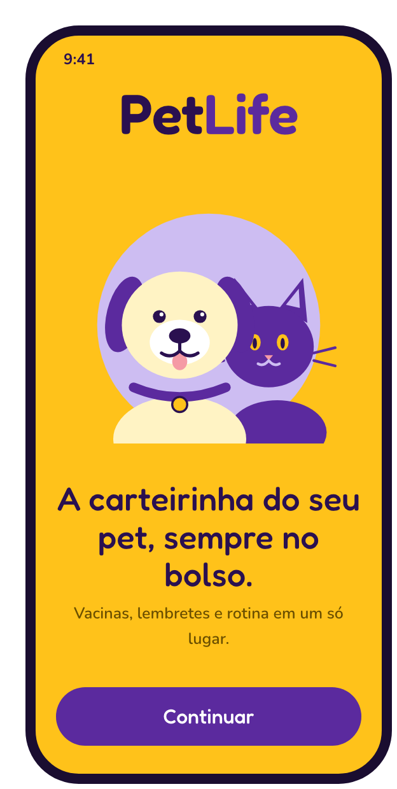<br><sub>Welcome</sub></td>
<td align="center">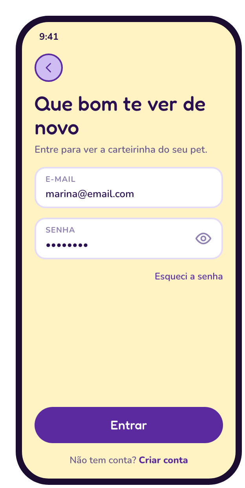<br><sub>Login</sub></td>
<td align="center">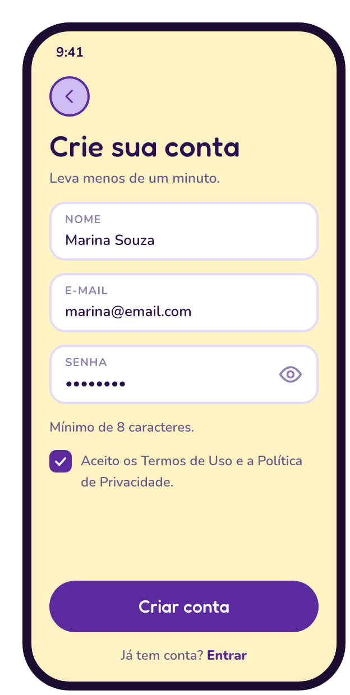<br><sub>Sign up</sub></td>
<td align="center">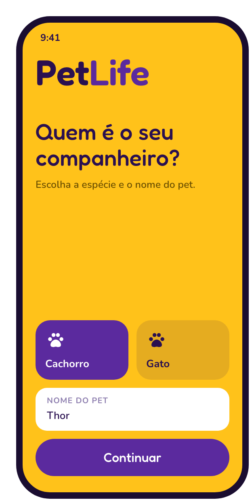<br><sub>New pet</sub></td>
</tr>
<tr>
<td align="center">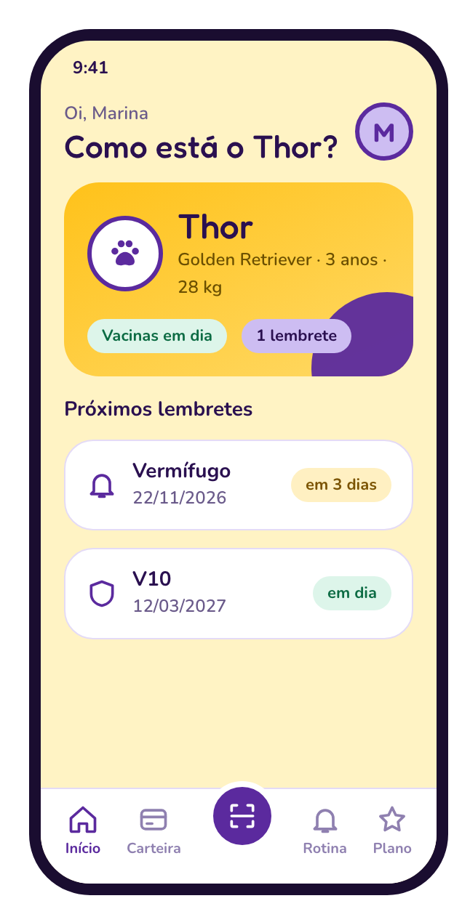<br><sub>Home</sub></td>
<td align="center">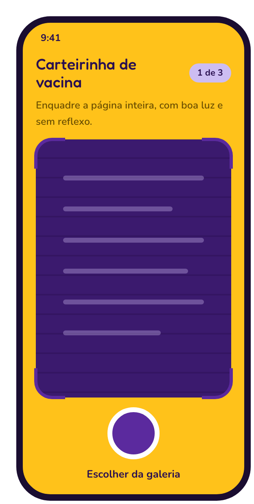<br><sub>Scan the card</sub></td>
<td align="center">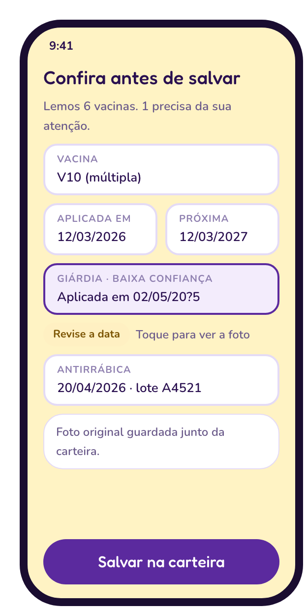<br><sub>Review the reading</sub></td>
<td align="center">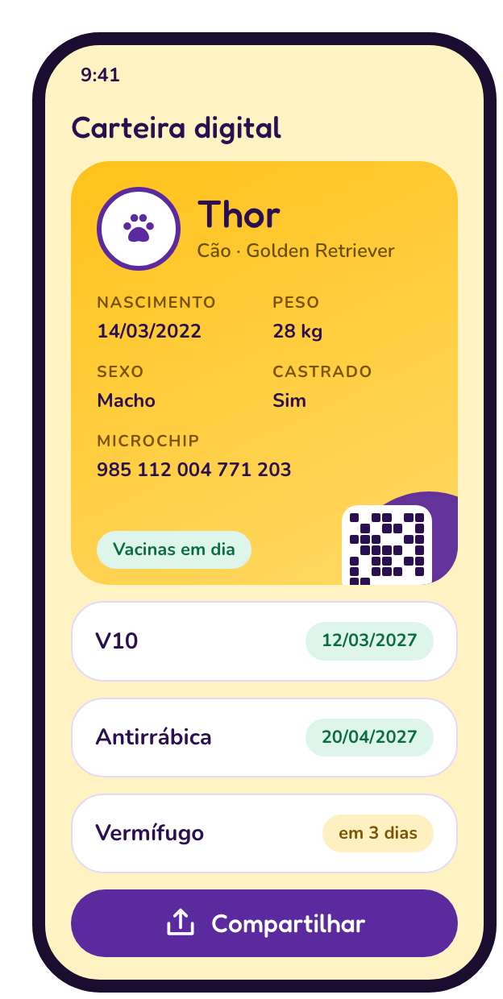<br><sub>Digital card</sub></td>
</tr>
<tr>
<td align="center">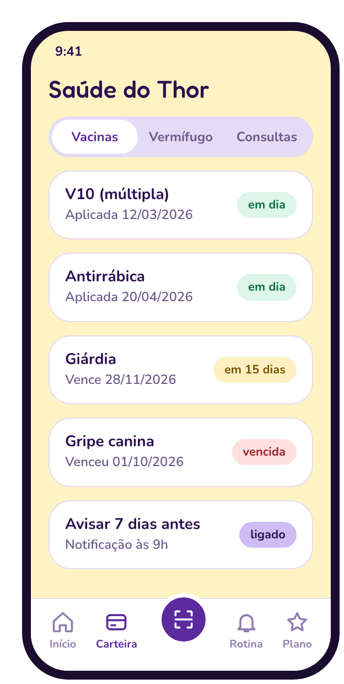<br><sub>Vaccines and reminders</sub></td>
<td align="center">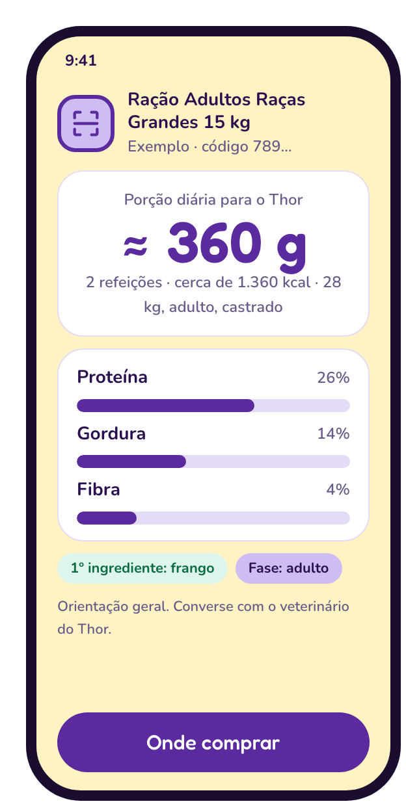<br><sub>Food analysis</sub></td>
<td align="center">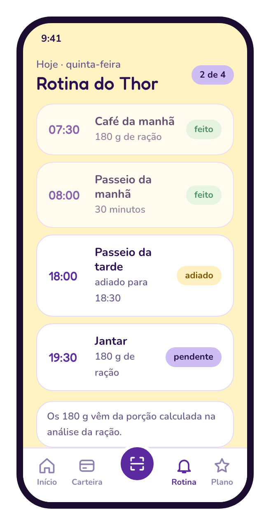<br><sub>Daily routine</sub></td>
<td align="center">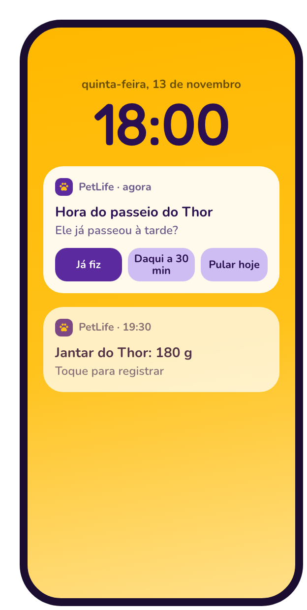<br><sub>Notification actions</sub></td>
</tr>
<tr>
<td align="center">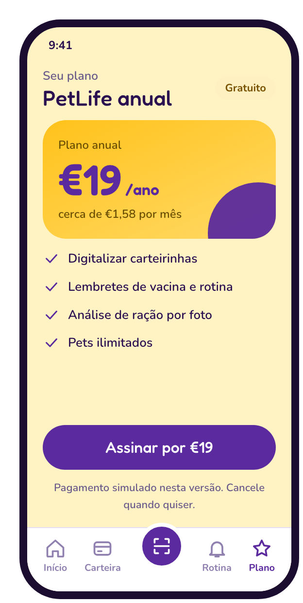<br><sub>Plan</sub></td>
<td align="center">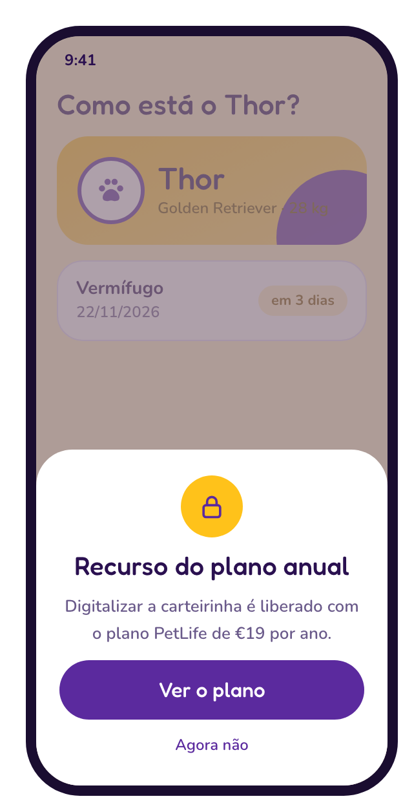<br><sub>Locked feature</sub></td>
<td></td>
<td></td>
</tr>
</table>

## Features (v1)

- **Digital vaccination card:** take a photo of the paper card, the AI reads it, and you review every field before saving.
- **Reminders:** notifications 7 days and 1 day before each vaccine or dewormer expires.
- **Daily routine:** feeding and walk times, with quick actions right on the notification (done, snooze 30 min, skip today).
- **Food analysis:** scan the barcode or the label to see the composition and the daily portion calculated from the pet's weight.
- **Account and plan:** email and password login (own authentication), and a single annual plan of €19 per year that unlocks all features.

## Tech stack

**App:** React Native, Expo SDK 58, Expo Router, TypeScript, StyleSheet with theme tokens (no UI framework).

**Planned:** own authentication (JWT) and API (Node and TypeScript) with Postgres, Stripe, TanStack Query, AI vision for card and label reading.

## Architecture

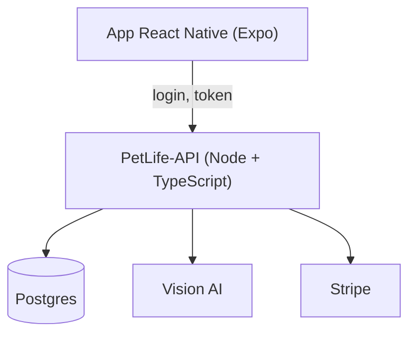

The app is organized **by feature**. Each feature keeps its own screens, components, hooks, API calls, utils and types, and a public `index.ts`:

```
src/
├─ app/          routes (Expo Router), thin files that import the feature screens
├─ features/     auth, pets, vaccine-card, reminders, routine, food-scan, plan
├─ shared/       components, hooks, api clients, theme, utils
└─ providers/    session and plan state
```

Dependency rule: `app` imports from `features`, `features` import from `shared`, a feature only imports another through its `index.ts`, and `shared` imports nothing.

Details in [`docs/architecture.md`](docs/architecture.md).

## Getting started

Requirements: Node 20 or newer and the [Expo Go](https://expo.dev/go) app on your phone (or an iOS simulator or Android emulator).

```bash
git clone https://github.com/elispethke/Pet-Life-App.git
cd Pet-Life-App
npm install
npm start
```

Scan the QR code with Expo Go, or press `i` (iOS simulator) or `a` (Android emulator) in the terminal.

Useful scripts:

```bash
npx tsc --noEmit   # type check
npx expo lint      # lint
```

## Documentation

- [`docs/product.md`](docs/product.md): problem, scope, plans and business rules
- [`docs/screens.md`](docs/screens.md): visual identity and description of the 14 screens
- [`docs/architecture.md`](docs/architecture.md): structure, data model and API
- [`docs/diario.md`](docs/diario.md): learning log with each step, the decisions and interview questions

## Roadmap

- [x] Product spec, screen designs and architecture
- [x] Expo project, theme tokens and fonts
- [ ] Expo Router, base components and Welcome screen
- [ ] Own authentication (JWT) with a study API, then the database
- [ ] New pet, bottom tabs, Plan and locked features (mock)
- [ ] Own API and Postgres
- [ ] Vaccination card, reminders, routine and food analysis
- [ ] Stripe annual plan
- [ ] AI vision for the card and the food label

## Author

Developed by **[Elis Pethke](https://github.com/elispethke)**.

## License

[MIT](LICENSE)
