<div align="center">


# PetLife

**A carteirinha do seu pet, sempre no bolso.**

App mobile para tutores de cães e gatos: digitalize a carteirinha de vacinação de papel por foto, receba lembretes e acompanhe comida e passeios.


[English](README.md) · **Português**

</div>

---

## Sobre

A carteirinha de vacinação é de papel, a letra é difícil de ler e ninguém lembra quando cada dose vence. Creche, hotel e banho e tosa pedem o comprovante na hora, e a carteirinha está em casa.

O PetLife transforma a carteirinha de papel em uma carteira digital organizada, avisa antes de cada dose vencer e ajuda no cuidado do dia a dia (refeições, passeios e quanta ração o pet precisa).

É um projeto de portfólio e de aprendizado, construído passo a passo com arquitetura por feature, para que cada parte seja fácil de encontrar e de explicar.

## Status

| Área | Situação |
|---|---|
| Especificação do produto, design de 14 telas e arquitetura | Concluído |
| Projeto Expo, TypeScript, tokens de tema e fontes (Fredoka e Nunito) | Concluído |
| Telas de Abertura, Login, Criar conta e Novo pet (entrada simulada) | Concluído |
| Barra inferior, Início, Carteira, Saúde, Rotina, Análise da ração, Plano e Recurso bloqueado (dados simulados em memória) | Concluído |
| API própria (Node e TypeScript) e banco Postgres | Planejado |
| Dados reais de carteirinha, lembretes, rotina e ração (dependem da API) | Planejado |
| Stripe para o plano anual | Planejado |
| IA de visão para ler a carteirinha e o rótulo | Planejado |

As telas abaixo são **protótipos de design**, ainda não o app rodando. Elas serão trocadas por capturas reais conforme cada tela for implementada.

## Telas

<table>
<tr>
<td align="center">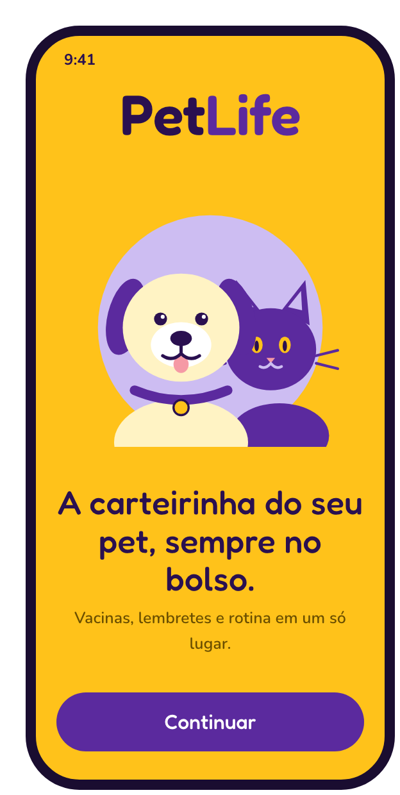<br><sub>Abertura</sub></td>
<td align="center">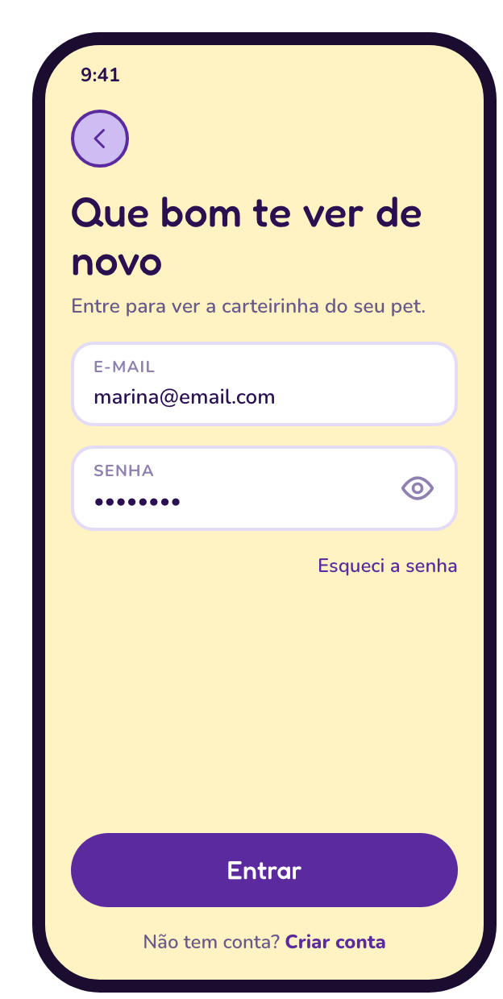<br><sub>Login</sub></td>
<td align="center">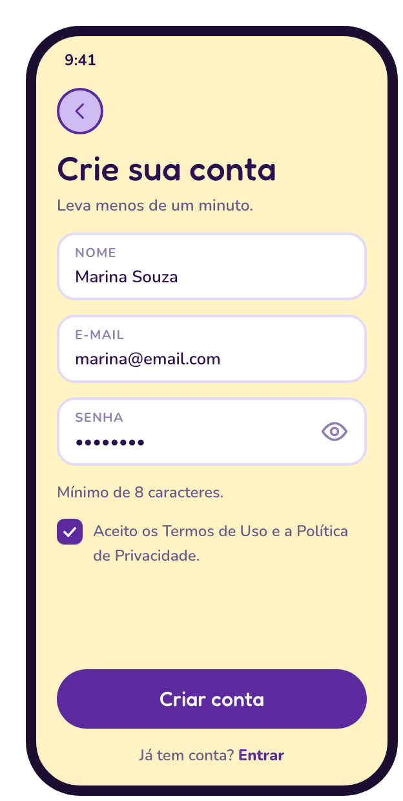<br><sub>Criar conta</sub></td>
<td align="center">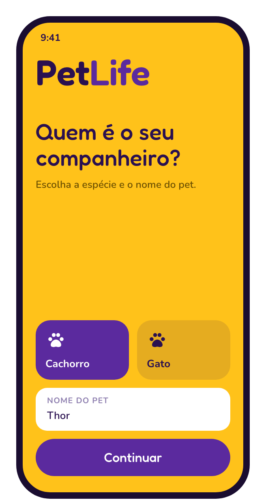<br><sub>Novo pet</sub></td>
</tr>
<tr>
<td align="center">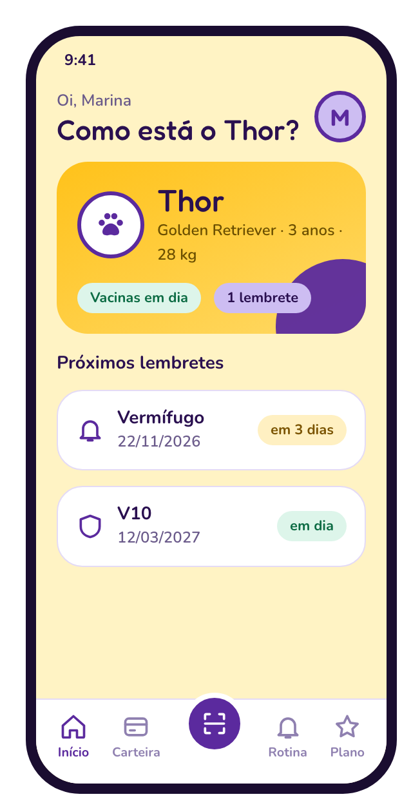<br><sub>Início</sub></td>
<td align="center">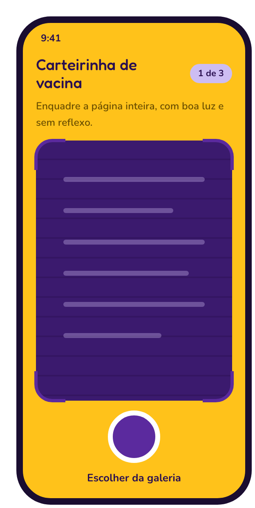<br><sub>Escanear carteirinha</sub></td>
<td align="center">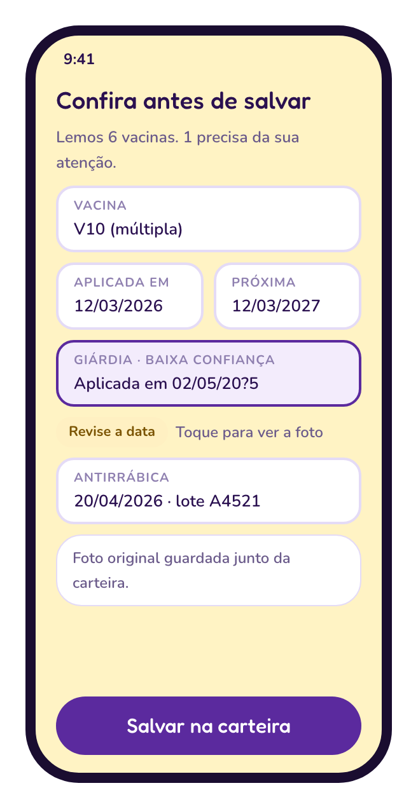<br><sub>Revisar leitura</sub></td>
<td align="center">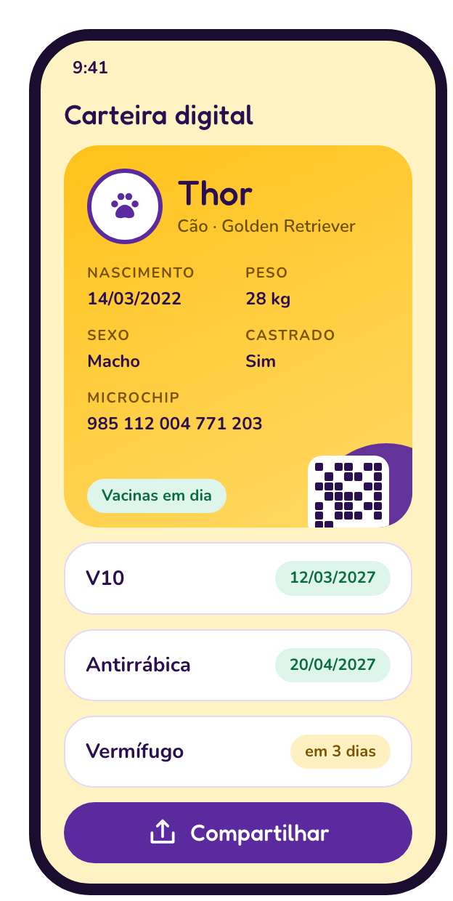<br><sub>Carteira digital</sub></td>
</tr>
<tr>
<td align="center">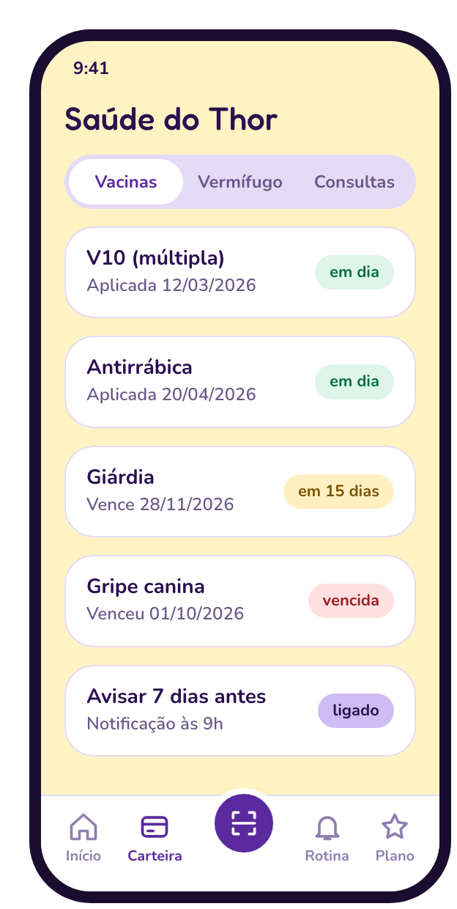<br><sub>Vacinas e lembretes</sub></td>
<td align="center">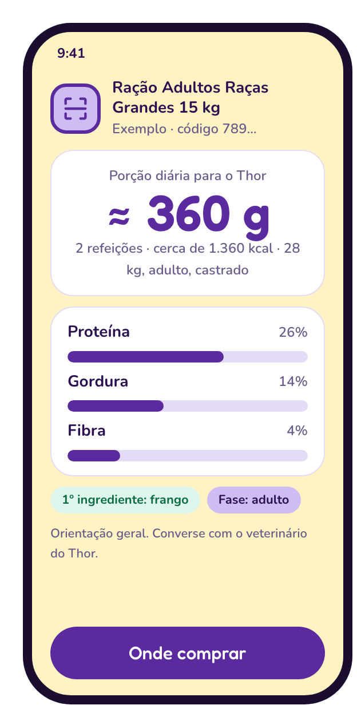<br><sub>Análise da ração</sub></td>
<td align="center">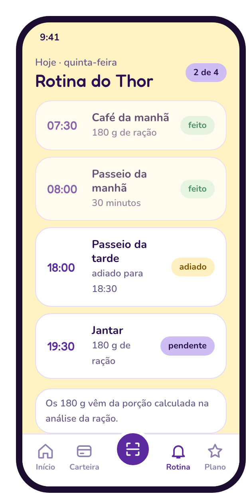<br><sub>Rotina</sub></td>
<td align="center">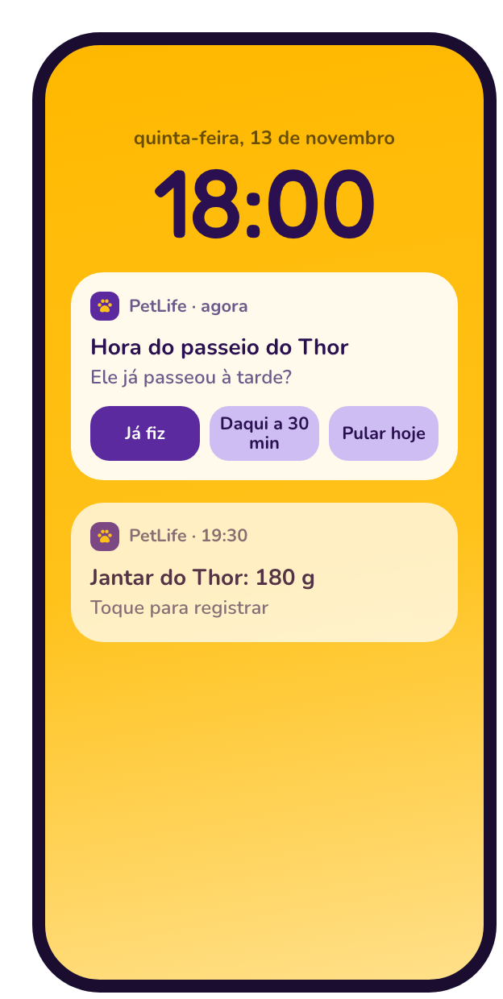<br><sub>Aviso com ações</sub></td>
</tr>
<tr>
<td align="center">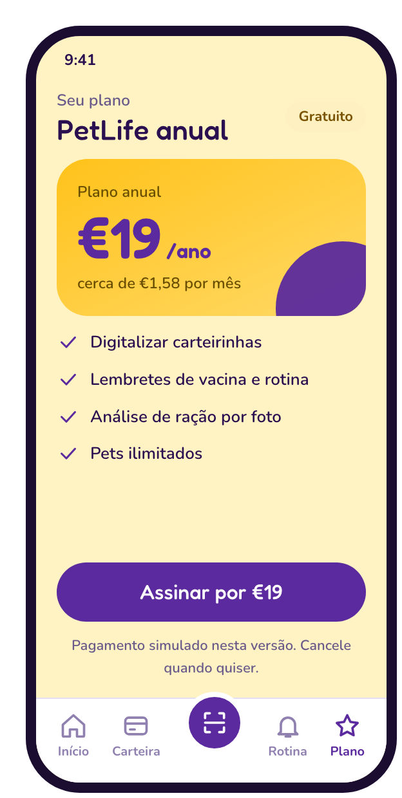<br><sub>Plano</sub></td>
<td align="center">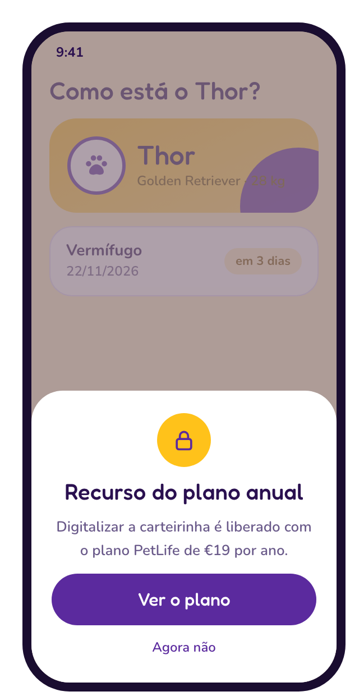<br><sub>Recurso bloqueado</sub></td>
<td></td>
<td></td>
</tr>
</table>

## Funcionalidades (v1)

- **Carteirinha digital:** foto da carteirinha de papel, a IA lê e você revisa cada campo antes de salvar.
- **Lembretes:** notificações 7 dias e 1 dia antes de cada vacina ou vermífugo vencer.
- **Rotina diária:** horários de comida e passeio, com ações rápidas na própria notificação (já fiz, daqui a 30 min, pular hoje).
- **Análise de ração:** leia o código de barras ou o rótulo para ver a composição e a porção diária calculada pelo peso do pet.
- **Conta e plano:** login com e-mail e senha e um único plano anual de €19 por ano que libera todos os recursos.

## Tecnologias

**App:** React Native, Expo SDK 58, Expo Router, TypeScript, StyleSheet com tokens de tema (sem framework de UI).

**Planejado:** autenticação própria (JWT) e API (Node e TypeScript) com Postgres, Stripe, TanStack Query e IA de visão para leitura de carteirinha e rótulo.

## Arquitetura

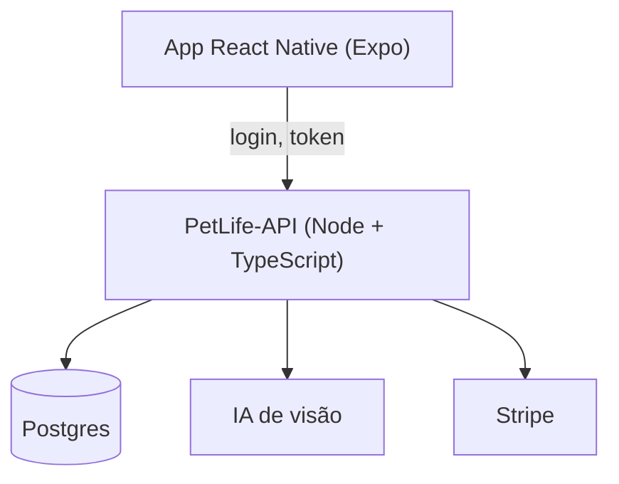

O app é organizado **por feature**. Cada feature guarda suas telas, componentes, hooks, chamadas de API, utilitários e tipos, e um `index.ts` público:

```
src/
├─ app/          rotas (Expo Router), arquivos finos que importam as telas das features
├─ features/     auth, pets, vaccine-card, reminders, routine, food-scan, plan
├─ shared/       componentes, hooks, clientes de api, tema, utilitários
└─ providers/    estado de sessão e de plano
```

Regra de dependência: `app` importa de `features`, `features` importam de `shared`, uma feature só importa outra pelo `index.ts`, e `shared` não importa nada.

Detalhes em [`docs/architecture.md`](docs/architecture.md).

## Como rodar

Requisitos: Node 20 ou superior e o app [Expo Go](https://expo.dev/go) no celular (ou simulador de iOS ou emulador de Android).

```bash
git clone https://github.com/elispethke/Pet-Life-App.git
cd Pet-Life-App
npm install
npm start
```

Escaneie o QR code com o Expo Go, ou aperte `i` (simulador de iOS) ou `a` (emulador de Android) no terminal.

Scripts úteis:

```bash
npx tsc --noEmit   # checagem de tipos
npx expo lint      # lint
```

## Documentação

- [`docs/product.md`](docs/product.md): problema, escopo, planos e regras de negócio
- [`docs/screens.md`](docs/screens.md): identidade visual e descrição das 14 telas
- [`docs/architecture.md`](docs/architecture.md): estrutura, modelo de dados e API
- [`docs/diario.md`](docs/diario.md): diário de aprendizado com cada etapa, as decisões e perguntas de entrevista

## Roadmap

- [x] Especificação do produto, design das telas e arquitetura
- [x] Projeto Expo, tokens de tema e fontes
- [ ] Expo Router, componentes de base e tela de Abertura
- [ ] Autenticação própria (JWT) com uma API de estudo e depois o banco
- [ ] Novo pet, abas inferiores, Plano e recursos bloqueados (mock)
- [ ] API própria e Postgres
- [ ] Carteirinha, lembretes, rotina e análise de ração
- [ ] Plano anual com Stripe
- [ ] IA de visão para a carteirinha e o rótulo

## Autora

Desenvolvido por **[Elis Pethke](https://github.com/elispethke)**.

## Licença

[MIT](LICENSE)
