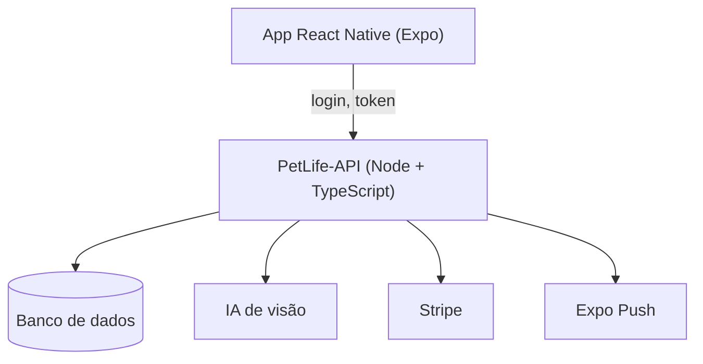

# PetLife: arquitetura

## Visão geral
O app Expo (React Native) conversa com uma **API própria** (projeto separado `PetLife/PetLife-API`, Node e TypeScript) que faz a **autenticação própria** (cadastro, login, tokens JWT de acesso e de renovação) e, depois, guarda os dados no **Postgres**. A API valida o token em toda requisição, chama a IA de visão (Claude) para ler carteirinha e rótulo e fala com o Stripe. As chaves da IA e do Stripe ficam só na API, nunca no app.

Decisão de portfólio e estudo: construir o próprio backend e a própria autenticação, para entender e mostrar o sistema completo (app, API, banco, autenticação, pagamento). O Firebase foi retirado do projeto.



## Fases de integração (uma de cada vez)
1. **Front-end com dados simulados** (fase atual): telas e navegação completas, com estado em memória atrás de funções em `api/` com a assinatura final.
2. **Autenticação própria com API de estudo:** `PetLife-API` mínima com cadastro, login, `/me`, renovação e saída (JWT, senha com hash), e o app guardando os tokens com segurança.
3. **Banco de dados e dados reais** (pets, carteirinha, rotina) na mesma API.
4. **Stripe** para o plano anual de €19. Atenção: Apple e Google exigem compra interna (IAP) para assinaturas de recursos digitais dentro do app; o Stripe serve para a web e demonstração, e para as lojas é preciso avaliar IAP.
5. **IA de visão** (carteirinha e rótulo) na API.

## Stack do app
Expo SDK 58, React Native 0.88, React 19, TypeScript. Navegação: Expo Router (rotas em `src/app/`). Dados do servidor: TanStack Query. Estilo: StyleSheet com tokens de tema (NÃO usar NativeWind nem Tailwind).

## Estrutura de pastas (alvo)
React Native não usa CSS: o "css" de cada componente é um arquivo `.styles.ts` com `StyleSheet.create` lendo os tokens do tema.

```
PetLife-App/
├─ src/
│  ├─ app/                    Expo Router: só rotas, arquivos finos que importam a tela da feature
│  │  ├─ (auth)/              abertura (welcome), login, cadastro (signup)
│  │  └─ (app)/               após o login: novo pet e abas (início, carteira, escanear, rotina, plano)
│  ├─ features/
│  │  ├─ auth/                abertura, login, cadastro, sessão
│  │  ├─ pets/                perfil do pet
│  │  ├─ vaccine-card/        digitalizar, revisar, carteira digital
│  │  ├─ reminders/           motor de notificações (vacinas e rotina)
│  │  ├─ routine/             comida e passeio: horários, avisos com ações, histórico
│  │  ├─ food-scan/           ração: código de barras, foto, análise, porção
│  │  ├─ sharing/             v1.5: link com validade e QR
│  │  └─ plan/                plano anual, bloqueio de recursos, Stripe (mock agora)
│  │     cada feature: screens/<Tela>/ (um pasta por tela), api/ utils/ hooks/ services/ types.ts index.ts
│  ├─ shared/
│  │  ├─ components/          Button, TextField, Screen, Logo, PetIllustration, Chip, Card...
│  │  ├─ hooks/               useOnline
│  │  ├─ api/                 clientes HTTP e erros
│  │  ├─ theme/               colors, typography, spacing, fonts (JÁ EXISTE)
│  │  ├─ utils/               date, format
│  │  └─ config/              env, constants
│  └─ providers/              AuthProvider, PlanProvider, QueryProvider
├─ docs/                      contexto do projeto, telas em PNG, diário de aprendizado e prompts
├─ .maestro/                  fluxos E2E do Maestro (cada fluxo começa com clearState)
└─ testes unitários           ao lado de cada arquivo (Nome.test.ts ou Nome.test.tsx); veja docs/testing.md
```
O backend fica em outro projeto, `PetLife/PetLife-API`, criado numa etapa futura.

## Estrutura por tela
Cada tela vive em uma pasta própria, com tudo dela junto. Exemplo da feature `auth`:

```
src/features/auth/
├─ screens/
│  ├─ Welcome/
│  │  ├─ WelcomeScreen.tsx
│  │  ├─ WelcomeScreen.styles.ts
│  │  ├─ WelcomeScreen.test.tsx
│  │  └─ index.ts
│  ├─ Login/
│  │  ├─ LoginScreen.tsx
│  │  ├─ LoginScreen.styles.ts
│  │  ├─ useLoginForm.ts           hook usado só por esta tela
│  │  ├─ LoginScreen.test.tsx
│  │  ├─ useLoginForm.test.ts
│  │  ├─ components/               componentes usados só por esta tela
│  │  └─ index.ts
│  └─ Signup/                      mesma estrutura (com components/TermsCheckbox/)
├─ api/                            auth.api.ts (+ testes)
├─ utils/                          validators.ts, mapAuthError.ts (+ testes)
├─ types.ts
└─ index.ts                        API pública da feature
```

- **Componentes compartilhados** (usados por 2 ou mais telas) ficam em `src/shared/components/Nome/` (`Nome.tsx`, `Nome.styles.ts`, `Nome.test.tsx`, `index.ts`): Button, BackButton, TextField, Screen, Logo, PetIllustration.
- Regra de subida: componente usado por uma tela só fica dentro da pasta dela; quando uma segunda tela o usar, ele sobe para `shared/components`.
- O que serve a feature inteira (api, utils, tipos e hooks de várias telas) fica na raiz da feature.
- Os arquivos de rota em `src/app/` continuam finos: só importam a tela da pasta correspondente.

## Convenção de estilos
O estilo vive sempre em arquivo separado do componente, e o componente só o chama.

```
Button/
├─ Button.tsx          só estrutura e comportamento: import { styles } from './Button.styles'
├─ Button.styles.ts    StyleSheet.create com tokens do tema; exporta `styles`
└─ index.ts            exporta o componente
```

- No `.tsx`: `<View style={styles.container}>`. Sem `StyleSheet`, sem `const styles` e sem `style={{ ... }}`.
- Variantes e estados ficam no `.styles.ts` (por exemplo `styles.variant.primary`), e o componente só escolhe qual aplicar.
- Só tokens de `@/shared/theme`: nenhuma cor, tamanho ou fonte escrita à mão.
- Nada de `.styles.ts` dentro de `src/app/`, porque todo arquivo ali vira uma rota.
- O lint garante a regra (`no-restricted-syntax` contra `StyleSheet.create` em `.tsx` e contra estilo inline).

## Responsabilidades
- **screens:** compõem componentes e chamam hooks. Sem regra de negócio e sem chamada de rede.
- **components:** visuais puros, recebem props, pasta própria com `Componente.tsx`, `Componente.styles.ts` e `index.ts`.
- **hooks:** estado e lógica da tela; usam TanStack Query e chamam a camada `api`.
- **api:** único lugar que fala com a API (ou com os dados simulados); devolve dados tipados. Nas etapas de mock, devolve dados simulados com a mesma assinatura que terá a versão real, para trocar sem mexer nas telas.
- **utils e services:** funções puras (validação, porção, status da vacina) e serviços (agendar notificação).
- **shared:** tema, componentes de base e clientes; não conhece nenhuma feature.
- **providers:** estado global (sessão do usuário, plano) exposto por contexto e hook (`useAuth`, `usePlan`).

## Regras de dependência
`app` importa de `features`; `features` importam de `shared`; uma feature só importa outra pelo `index.ts`; `shared` não importa de ninguém. Fluxo dentro da feature: tela, hook, api, cliente.

## Autenticação e acesso
- Uma única proteção por login, na raiz do app: sem sessão só existem as telas de `(auth)`; com sessão só as de `(app)`. Sem segunda proteção em cascata.
- "Ainda não tem pet" não é proteção de rota: é um redirecionamento comum, feito em um só lugar (a entrada do grupo `(app)`), para a tela Novo pet.
- A sessão vive em `AuthProvider` (simulada agora; depois tokens da `PetLife-API`). O plano vive em `PlanProvider`, e o hook `useFeatureGate` decide se um recurso está liberado e, se não, abre a tela Recurso bloqueado.
- Tabela de todas as rotas e quem leva até cada uma: `docs/navigation.md` (fonte única).

## Modelo de dados (Postgres)
O dono dos dados é o usuário autenticado (`owner_id`). A API filtra sempre por ele.
- `pets`: id, owner_id, species (dog|cat), name, breed, birth_date, sex, neutered, microchip, weight_kg, photo_path
- `pet_weights`: id, pet_id, weight_kg, measured_on
- `vaccine_scans`: id, pet_id, image_path, status (pending|ready|reviewed), raw_json, created_at
- `vaccine_records`: id, pet_id, scan_id, kind (vaccine|dewormer), name, applied_on, next_due_on, batch, vet_name, confidence, reviewed
- `reminders`: id, record_id, remind_on, sent_at
- `routine_items`: id, pet_id, kind (meal|walk), label, time, weekdays[], amount_g, duration_min, active
- `routine_logs`: id, item_id, date, status (done|skipped|snoozed), snoozed_until, logged_by, logged_at
- `food_products`: barcode, name, brand, species, life_stage, protein_pct, fat_pct, fiber_pct, kcal_per_kg, ingredients[], source
- `food_scans`: id, pet_id, image_path, product_barcode, result_json, created_at
- `share_links`: id, pet_id, token, expires_at, revoked_at
- `subscriptions`: id, owner_id, plan (annual), status, current_period_end, provider (stripe), provider_ref

## API (PetLife-API)
- `POST /scan-vaccine-card`: recebe a imagem, chama a IA de visão, devolve vacinas em JSON com confiança por campo.
- `POST /scan-food-label`: lê o rótulo da foto e devolve composição estruturada.
- `GET /food/:barcode`: busca produto na base própria.
- `POST /share-link` e `GET /public/card/:token`: link público somente leitura com validade.
- `POST /billing/checkout-session`: cria a sessão de pagamento do plano anual no Stripe.
- `POST /stripe-webhook`: atualiza o plano do usuário quando a assinatura muda.
Toda rota (menos cadastro, login, renovação, o webhook e a página pública) exige o token de acesso da própria API.

## Notificações
Um motor único de lembretes (vacinas e rotina). Horários fixos usam notificações locais agendadas em janela de 7 dias, reagendadas a cada abertura (limite de cerca de 64 pendentes no iOS). Botões de ação: "Já fiz", "Daqui a 30 min", "Pular hoje". O aviso condicional entre dois tutores (v1.5) exige push do servidor.

## Segurança
Senhas com hash (nunca em texto), tokens de acesso curtos e de renovação rotacionados, segredos em variáveis de ambiente fora do Git, erros genéricos no login (sem dizer se o e-mail existe), a API filtra sempre por `owner_id`, imagens em armazenamento privado com URL assinada, e chaves da IA e do Stripe só na API. Dados pessoais conforme LGPD e GDPR (aceite dos termos no cadastro).
