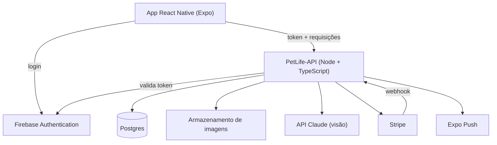

# PetLife: arquitetura

## Visão geral
O app Expo (React Native) usa o **Firebase Authentication** para login e conversa com uma **API própria** (projeto separado `PetLife/PetLife-API`, Node e TypeScript) com **banco Postgres próprio**. A API valida o token do Firebase em toda requisição, guarda os dados, chama a IA de visão (Claude) para ler carteirinha e rótulo e fala com o Stripe. As chaves da IA e do Stripe ficam só na API, nunca no app.

Decisão de portfólio: criar o próprio backend e banco, em vez de usar um backend pronto, para mostrar o sistema completo (app, API, banco, autenticação, pagamento).



## Fases de integração (um passo de cada vez)
1. **Mock:** telas e estado simulados no app (autenticação, plano, dados). É a fase atual.
2. **Firebase Authentication** no app (e-mail e senha). Decidir entre o SDK web do Firebase (funciona no Expo Go) e `@react-native-firebase` (exige development build).
3. **PetLife-API + Postgres** com validação do token do Firebase.
4. **Telas de dados reais** (pets, carteirinha, rotina) ligadas à API.
5. **Stripe** para o plano anual de €19. Atenção: Apple e Google exigem compra interna (IAP) para assinaturas de recursos digitais dentro do app. Stripe serve para a web e para demonstração; para publicar nas lojas, avaliar IAP (por exemplo com RevenueCat).
6. **IA de visão** (carteirinha e rótulo) na API.

## Stack do app
Expo SDK 58, React Native 0.88, React 19, TypeScript. Navegação: Expo Router (rotas em `src/app/`). Dados do servidor: TanStack Query. Estilo: StyleSheet com tokens de tema (NÃO usar NativeWind nem Tailwind).

## Estrutura de pastas (alvo)
React Native não usa CSS: o "css" de cada componente é um arquivo `.styles.ts` com `StyleSheet.create` lendo os tokens do tema.

```
PetLife-App/
├─ src/
│  ├─ app/                    Expo Router: só rotas, arquivos finos que importam a tela da feature
│  │  ├─ (auth)/              abertura (welcome), login, cadastro (signup)
│  │  └─ (app)/               após o login: novo pet e abas (início, carteira, escanear, rotina, plano)
│  ├─ features/
│  │  ├─ auth/                abertura, login, cadastro, sessão
│  │  ├─ pets/                perfil do pet
│  │  ├─ vaccine-card/        digitalizar, revisar, carteira digital
│  │  ├─ reminders/           motor de notificações (vacinas e rotina)
│  │  ├─ routine/             comida e passeio: horários, avisos com ações, histórico
│  │  ├─ food-scan/           ração: código de barras, foto, análise, porção
│  │  ├─ sharing/             v1.5: link com validade e QR
│  │  └─ plan/                plano anual, bloqueio de recursos, Stripe (mock agora)
│  │     cada feature: screens/ components/ hooks/ api/ utils/ services/ types.ts index.ts
│  ├─ shared/
│  │  ├─ components/          Button, TextField, Screen, Logo, PetIllustration, Chip, Card...
│  │  ├─ hooks/               useOnline
│  │  ├─ api/                 clientes HTTP e erros
│  │  ├─ theme/               colors, typography, spacing, fonts (JÁ EXISTE)
│  │  ├─ utils/               date, format
│  │  └─ config/              env, constants
│  └─ providers/              AuthProvider, PlanProvider, QueryProvider
├─ docs/                      contexto do projeto, telas em PNG, diário de aprendizado e prompts
└─ tests/                     primeiro as funções puras: validators, vaccineStatus, calcDailyPortion
```
O backend fica em outro projeto, `PetLife/PetLife-API`, criado numa etapa futura.

## Responsabilidades
- **screens:** compõem componentes e chamam hooks. Sem regra de negócio e sem chamada de rede.
- **components:** visuais puros, recebem props, pasta própria com `Componente.tsx`, `Componente.styles.ts` e `index.ts`.
- **hooks:** estado e lógica da tela; usam TanStack Query e chamam a camada `api`.
- **api:** único lugar que fala com Firebase ou com a API; devolve dados tipados. Nas etapas de mock, devolve dados simulados com a mesma assinatura que terá a versão real, para trocar sem mexer nas telas.
- **utils e services:** funções puras (validação, porção, status da vacina) e serviços (agendar notificação).
- **shared:** tema, componentes de base e clientes; não conhece nenhuma feature.
- **providers:** estado global (sessão do usuário, plano) exposto por contexto e hook (`useAuth`, `usePlan`).

## Regras de dependência
`app` importa de `features`; `features` importam de `shared`; uma feature só importa outra pelo `index.ts`; `shared` não importa de ninguém. Fluxo dentro da feature: tela, hook, api, cliente.

## Autenticação e acesso
- Sessão guardada em `AuthProvider` (mock agora; Firebase depois). Rotas protegidas: sem sessão, o grupo `(app)` redireciona para `(auth)`; com sessão, `(auth)` redireciona para `(app)`. Consultar na documentação do Expo Router v58 a forma recomendada de rotas protegidas.
- Plano guardado em `PlanProvider` (mock agora; depois vem da API/Stripe). Um hook único `useFeatureGate` decide se um recurso está liberado e, se não, abre a tela 14.

## Modelo de dados (Postgres)
O dono dos dados é o `uid` do Firebase (`owner_uid`). A API filtra sempre por ele.
- `pets`: id, owner_uid, species (dog|cat), name, breed, birth_date, sex, neutered, microchip, weight_kg, photo_path
- `pet_weights`: id, pet_id, weight_kg, measured_on
- `vaccine_scans`: id, pet_id, image_path, status (pending|ready|reviewed), raw_json, created_at
- `vaccine_records`: id, pet_id, scan_id, kind (vaccine|dewormer), name, applied_on, next_due_on, batch, vet_name, confidence, reviewed
- `reminders`: id, record_id, remind_on, sent_at
- `routine_items`: id, pet_id, kind (meal|walk), label, time, weekdays[], amount_g, duration_min, active
- `routine_logs`: id, item_id, date, status (done|skipped|snoozed), snoozed_until, logged_by, logged_at
- `food_products`: barcode, name, brand, species, life_stage, protein_pct, fat_pct, fiber_pct, kcal_per_kg, ingredients[], source
- `food_scans`: id, pet_id, image_path, product_barcode, result_json, created_at
- `share_links`: id, pet_id, token, expires_at, revoked_at
- `subscriptions`: id, owner_uid, plan (annual), status, current_period_end, provider (stripe), provider_ref

## API (PetLife-API)
- `POST /scan-vaccine-card`: recebe a imagem, chama a IA de visão, devolve vacinas em JSON com confiança por campo.
- `POST /scan-food-label`: lê o rótulo da foto e devolve composição estruturada.
- `GET /food/:barcode`: busca produto na base própria.
- `POST /share-link` e `GET /public/card/:token`: link público somente leitura com validade.
- `POST /billing/checkout-session`: cria a sessão de pagamento do plano anual no Stripe.
- `POST /stripe-webhook`: atualiza o plano do usuário quando a assinatura muda.
Toda rota (menos o webhook e a página pública) exige o token do Firebase.

## Notificações
Um motor único de lembretes (vacinas e rotina). Horários fixos usam notificações locais agendadas em janela de 7 dias, reagendadas a cada abertura (limite de cerca de 64 pendentes no iOS). Botões de ação: "Já fiz", "Daqui a 30 min", "Pular hoje". O aviso condicional entre dois tutores (v1.5) exige push do servidor.

## Segurança
A API valida o token do Firebase em toda rota e filtra por `owner_uid`. Imagens em armazenamento privado com URL assinada. Chaves da IA e do Stripe só na API. Dados pessoais conforme LGPD e GDPR (aceite dos termos no cadastro).
